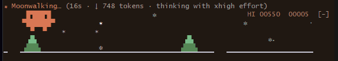
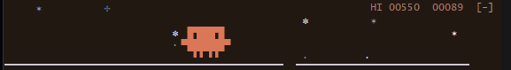

# Clawd for Claude Code

Clawd, Claude Code's mascot, in the snow above your prompt. When Claude is working he runs and jumps the trees, and if you click him he hops.

It comes with an orange-on-brown theme. In Windows Terminal and the VS Code terminal, the window also goes dark brown while Claude Code is open.





**To install it,** download `clawd-kit.zip` from the latest release, unzip it and follow the README inside. It covers Mac, Windows and Linux.

Unofficial fan mod, not made or endorsed by Anthropic. Clawd is Anthropic's character. The code is MIT (see `LICENSE`); the character isn't covered.

## Working on it

After cloning, turn on the pre-push hook:

```bash
git config core.hooksPath .githooks
```

| Path | Holds |
| --- | --- |
| `clawd-kit/` | Everything that ships: the mod (`clawd/`), the theme, `install.sh` and `install.ps1`, their uninstallers, and the install README |
| `clawd-kit/clawd/hooks/` | `register.tsx`, the scene and its hooks; `clawd-sprite.tsx`, one row of Clawd as a click region |
| `clawd-kit/clawd/tests/` | The mod's tests, run by `claude plugin test` |
| `tests/` | The installers' tests, each run in throwaway homes |
| `tools/make-zip.py` | Builds `clawd-kit.zip`, and with `--check` checks what goes into it |
| `check` | Every check, cheapest first; the pre-push hook runs it |
| `GOTCHAS.md` | Known traps, numbered; read before changing the mod or the installers |
| `docs/` | The README's pictures, cropped to the band |

- `./check` runs everything: syntax, the zip's files, `claude plugin validate`, the mod's tests and both installer suites (the PowerShell one where `powershell.exe` exists). About four minutes.
- A change to the mod or the installers comes with a test that fails without it.

## A release

1. Raise `version` in `clawd-kit/clawd/.claude-plugin/plugin.json`.
2. `./check`, then `python3 tools/make-zip.py` (`python` on Windows).
3. Commit, push, and attach `clawd-kit.zip` to a release tagged `v<version>`.

Running the installer over an earlier version upgrades it in place.
