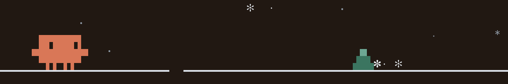
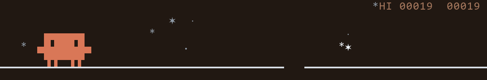

# Clawd for Claude Code

Clawd, Claude Code's mascot, in the snow above your prompt. When Claude is working he runs and jumps the trees, and if you click him he hops and sends up a heart. Between turns he wanders, looks around and naps.





Or pick the small blue Clawd, who hops snow-capped mountains instead. The installer asks which one you want, and running it again switches.


Each comes with a theme to match, orange on brown or blue on navy. In Windows Terminal and the VS Code terminal, the window also takes that colour while Claude Code is open.

**To install it,** download `clawd-kit.zip` from the latest release, unzip it and follow the README inside. It covers Mac, Windows and Linux.

Unofficial fan mod, not made or endorsed by Anthropic. Clawd is Anthropic's character. The code is MIT (see `LICENSE`); the character isn't covered.

## Working on it

After cloning, turn on the pre-push hook:

```bash
git config core.hooksPath .githooks
```

| Path | Holds |
| --- | --- |
| `clawd-kit/` | Everything that ships: the two mods, their themes, `install.sh` and `install.ps1`, their uninstallers, and the install README |
| `clawd-kit/clawd/` | The orange Clawd. `hooks/register.tsx` is the scene and its hooks, `hooks/clawd-sprite.tsx` one row of Clawd as a click region, `tests/` its tests |
| `clawd-kit/clawd-peaks/` | The small blue Clawd, laid out the same way |
| `tests/` | The installers' tests, each run in throwaway homes |
| `tools/make-zip.py` | Builds `clawd-kit.zip`, and with `--check` checks what goes into it |
| `tools/make-pictures.py` | Draws the pictures in `docs/` from the mods' own frames (needs Pillow) |
| `check` | Every check, cheapest first; the pre-push hook runs it |
| `GOTCHAS.md` | Known traps, numbered; read before changing a mod or the installers |
| `docs/` | The README's pictures |

- `./check` runs everything: syntax, the zip's files, `claude plugin validate` and the tests for both mods, and both installer suites (the PowerShell one where `powershell.exe` exists). About five minutes.
- A change to a mod or the installers comes with a test that fails without it.

## A release

1. Raise `version` in `clawd-kit/clawd/.claude-plugin/plugin.json`; that is the kit's version. Raise the blue one's too if it changed.
2. If either Clawd looks different, run `python3 tools/make-pictures.py` and look at what it drew.
3. `./check`, then `python3 tools/make-zip.py` (`python` on Windows).
4. Commit, push, and attach `clawd-kit.zip` to a release tagged `v<version>`.

Running the installer over an earlier version upgrades it in place.
